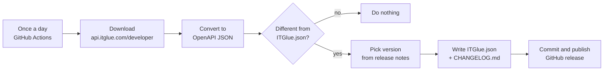

<div align="center">

# IT Glue OpenAPI

**An always-current, unofficial OpenAPI 3 spec for the IT Glue API, with a changelog and a GitHub release every time IT Glue changes something.**

[](https://github.com/Celerium/ITGlue-OpenAPI/actions/workflows/tests.yml)
[](https://github.com/Celerium/ITGlue-OpenAPI/actions/workflows/watch-itglue-api.yml)
[](https://github.com/Celerium/ITGlue-OpenAPI/releases/latest)


[Get the spec](#-get-the-spec) · [How it works](#-how-it-works) · [Run it yourself](#-run-it-yourself) · [Tests](#-tests) · [Changelog](CHANGELOG.md)

</div>

---

IT Glue documents its API at <https://api.itglue.com/developer/> but does not publish an OpenAPI spec, and it
does not version the API or announce changes. This project fixes that:

- 📄 **Converts** the developer documentation into [`ITGlue.json`](ITGlue.json), an OpenAPI 3.0.3 document.
- 🔍 **Watches** the documentation once a day and records exactly what changed (endpoints, parameters, request bodies, responses).
- 🏷️ **Releases** a new GitHub release with human-readable release notes whenever the API changes.
- 🧪 **Tested**: unit tests run on every push, and the committed spec is validated as OpenAPI.

> [!NOTE]
> This is a best-effort, community project. It is not published, maintained or endorsed by IT Glue or Kaseya.
> The spec reflects what the documentation says, which is not always what the live API does.

## 📦 Get the spec

| What you want | Where |
| --- | --- |
| Latest spec | [`ITGlue.json`](https://raw.githubusercontent.com/Celerium/ITGlue-OpenAPI/main/ITGlue.json) on `main` |
| A specific version | Download `ITGlue.json` from a [release](https://github.com/Celerium/ITGlue-OpenAPI/releases) |
| What changed and when | [Releases](https://github.com/Celerium/ITGlue-OpenAPI/releases) or [`CHANGELOG.md`](CHANGELOG.md) |
| Get notified of changes | **Watch → Custom → Releases** on this repository |

Point any OpenAPI tool at the raw URL: Swagger UI, Postman, Insomnia, `openapi-generator`, Kiota, and so on.

## 🏷️ Versioning

IT Glue has no API version, so the spec borrows the **IT Glue product version** from the
[release notes](https://help.itglue.kaseya.com/help/Content/0-HOME/Release-Notes.htm).

| Situation when the API change is detected | Spec version | Example |
| --- | --- | --- |
| IT Glue shipped a new product version since the last spec release | the product version | `1.118.133` |
| The product version is unchanged | product version + today's date (UTC) | `1.118.132.20261113` |
| A second change on the same day | the above + a revision | `1.118.132.20261113.2` |

The product version is stored in the spec itself (`info.x-itglue-product-version`), so the next run knows what to
compare against. A new product version with **no** API change does not create a release.

## ⚙️ How it works



- The comparison ignores the version fields, so a quiet day never rewrites the file or creates a commit.
- Safety net: if a run would shrink the spec by more than half, it is treated as a broken scrape and the run fails instead of overwriting the spec.
- The workflow lives in [`.github/workflows/watch-itglue-api.yml`](.github/workflows/watch-itglue-api.yml).
  It runs daily and can also be started manually from the **Actions** tab (with an optional *force* switch).

### What the converter extracts

- Every documented route (including alternative routes such as `/organizations/:organization_id/relationships/...`)
- Summaries, descriptions and resource groups (as tags)
- Path and query parameters with types, enums, required and nullable flags
- JSON:API request bodies (nested `data[attributes][...]` fields and bulk arrays)
- Documented error responses
- `x-api-key` authentication and the US / EU / AU servers

## 🚀 Run it yourself

You need **Python 3.10 or newer**. Nothing is sent anywhere except two `GET` requests to IT Glue's public documentation.

**1. Get the code and install it**

```bash
git clone https://github.com/Celerium/ITGlue-OpenAPI.git
cd ITGlue-OpenAPI
python -m venv .venv
```

Activate the virtual environment:

```powershell
# Windows (PowerShell)
.\.venv\Scripts\Activate.ps1
```

```bash
# macOS / Linux
source .venv/bin/activate
```

Then install:

```bash
pip install -e .
```

**2. Generate a spec**

Write to a scratch file so the tracked `ITGlue.json` is left alone:

```bash
itglue-openapi --output my-itglue.json --no-changelog
```

```text
Wrote my-itglue.json: version 1.118.132 (209 operations; 209 added, 0 removed, 0 modified).
```

Running the same command again reports `No API changes detected` and leaves the file untouched.

**3. Useful options**

| Option | What it does |
| --- | --- |
| `--output PATH` | OpenAPI JSON file to create or update (default `ITGlue.json`) |
| `--dry-run` | Show what would change without writing anything |
| `--no-changelog` | Do not touch `CHANGELOG.md` |
| `--changelog PATH` | Changelog to prepend the entry to (default `CHANGELOG.md`) |
| `--release-notes-file PATH` | Save markdown release notes here when something changed |
| `--product-version X.Y.Z` | Use this product version instead of reading the release notes |
| `--force` | Write even if nothing changed, or if the safety net tripped |
| `--github-output PATH` | Append `changed`, `version`, `tag`, ... for GitHub Actions |
| `--source-url URL` / `--release-notes-url URL` | Read the documentation from somewhere else (for example a saved copy) |

`python -m itglue_openapi` works the same as the `itglue-openapi` command.

## 🧪 Tests

```bash
pip install -e ".[dev]"
pytest          # unit tests, no network needed
ruff check .    # lint
```

The tests use saved HTML fixtures in [`tests/fixtures`](tests/fixtures), so they never call IT Glue. They cover
parsing, the OpenAPI output (including validating it with `openapi-spec-validator`), version selection, change
detection, the changelog and the command line.

## 🗂️ Repository layout

| Path | Purpose |
| --- | --- |
| [`ITGlue.json`](ITGlue.json) | The generated OpenAPI spec |
| [`CHANGELOG.md`](CHANGELOG.md) | One entry per detected API change |
| [`itglue_openapi/`](itglue_openapi) | The converter: `parser` → `builder` → `tracker` (+ `versioning`, `diff`, `cli`) |
| [`tests/`](tests) | Unit tests and HTML fixtures |
| [`.github/workflows/`](.github/workflows) | `tests.yml` (CI) and `watch-itglue-api.yml` (daily watcher and releases) |

## 🤝 Contributing

Found a parameter that is typed wrong or a page the parser misses? Open an issue or a pull request. Add a small
HTML snippet to `tests/fixtures/developer.html` and a test that fails without your fix.
